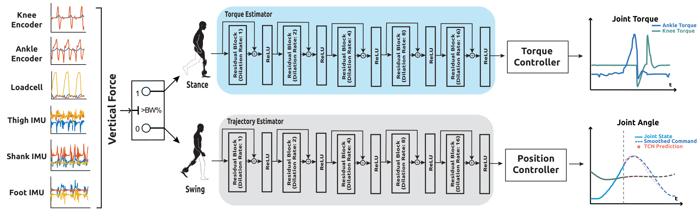

# End-to-End Control of a Powered Knee-Ankle Prosthesis Towards Unified, Tuning-Free Assistance

This repository contains the temporal convolutional network (TCN) architecture and the two pre-trained
models from the paper below.

> John Shim, Christoph P. O. Nuesslein, Sixu Zhou, Hanjun Kim, Kinsey Herrin, and Aaron J. Young,
> "End-to-End Control of a Powered Knee-Ankle Prosthesis Towards Unified, Tuning-Free Assistance,"
> submitted to the ASME Journal of Dynamic Systems, Measurement, and Control.

Contact: John Shim (jshim77@gatech.edu), Georgia Institute of Technology.



The vertical load cell force selects the model. When it exceeds a fraction of body weight (15% to enter stance,
25% to start swing), the leg is in stance and the `torque_estimator` predicts the knee and ankle joint moments
for the torque controller. Otherwise the leg is in swing and the `trajectory_estimator` predicts the future
knee and ankle angles for the position controller.

## Contents

| Path | Contents |
|---|---|
| `tcn.py` | TCN definition: five residual blocks with dilation rates 1 to 16, 64 channels each, followed by a linear layer |
| `models/torque_estimator/torque_estimator.tar` | Pre-trained stance model (PyTorch checkpoint) |
| `models/torque_estimator/torque_estimator_zscore.csv` | Mean and standard deviation of each input channel, used to normalize the inputs |
| `models/trajectory_estimator/trajectory_estimator.tar` | Pre-trained swing model (PyTorch checkpoint) |
| `models/trajectory_estimator/trajectory_estimator_zscore.csv` | Mean and standard deviation of each input channel, used to normalize the inputs |
| `figures/control_diagram_tcn_v3.png` | Control diagram shown above |
| `metadata/metadata.yml` | Title, description, authors and affiliations, corresponding contributor |
| `environment/Dockerfile`, `environment/postInstall` | Environment: Python 3.11 with the CPU build of PyTorch 2.2.2, NumPy 1.26.4 and pandas 2.2.2 |
| `LICENSE` | MIT License |

## Models

Both models take a window of the last 187 samples (1.87 s at 100 Hz) of the prosthesis sensors and return one
prediction for the newest sample.

| Model | Phase | Inputs | Outputs |
|---|---|---|---|
| `torque_estimator` | Stance | 28 channels | 2: ankle and knee joint moment (Nm/kg), 40 ms ahead of the newest sample |
| `trajectory_estimator` | Swing | 29 channels | 60: ankle angle for the next 30 samples, then knee angle for the next 30 samples (deg, 10 ms apart, 300 ms in total) |

Input channels, in order. The `torque_estimator` uses the first 28; the `trajectory_estimator` also uses
`thigh_orientation`.

```
ankle_theta, ankle_thetadot,
foot_accelX, foot_accelY, foot_accelZ, foot_gyroX, foot_gyroY, foot_gyroZ,
forceX, forceY, forceZ,
knee_theta, knee_thetadot,
momentX, momentY, momentZ,
shank_accelX, shank_accelY, shank_accelZ, shank_gyroX, shank_gyroY, shank_gyroZ,
thigh_accelX, thigh_accelY, thigh_accelZ, thigh_gyroX, thigh_gyroY, thigh_gyroZ,
thigh_orientation
```

## Environment

The code was tested with Python 3.11, PyTorch 2.2.2 (CPU), NumPy 1.26.4 and pandas 2.2.2. A GPU is not needed.

With Docker:

```bash
docker build -t e2e-prosthesis environment
docker run --rm -it -v "$PWD":/code -w /code e2e-prosthesis python
```

Without Docker, in a new Python 3.11 virtual environment:

```bash
python3 -m venv .venv
source .venv/bin/activate
bash environment/postInstall
```

## Usage

Run from the repository root:

```python
import numpy as np
import pandas as pd
import torch

from tcn import TCN


def load_model(name):
    ckpt = torch.load(f"models/{name}/{name}.tar", map_location="cpu", weights_only=False)
    state_dict = ckpt.pop("state_dict")
    model = TCN(**ckpt)  # the checkpoint stores the constructor arguments
    model.load_state_dict(state_dict)
    model.eval()
    zscore = pd.read_csv(f"models/{name}/{name}_zscore.csv")
    mean = zscore["mean"].to_numpy(np.float32)
    std = zscore["std"].to_numpy(np.float32)
    window = ckpt["eff_hist"] + 1  # 187 samples
    return model, mean, std, window


model, mean, std, window = load_model("torque_estimator")

# x: the last `window` samples of the input channels, in the order listed above, shape (window, channels)
x = np.zeros((window, len(mean)), dtype=np.float32)
x = (x - mean) / std
with torch.no_grad():
    y = model(torch.from_numpy(x.T[None]))  # input (batch, channels, window); output (batch, outputs)
ankle_moment, knee_moment = y[0].tolist()
```

## License

MIT License. See `LICENSE`.
